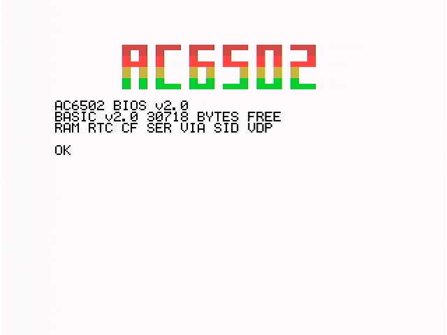
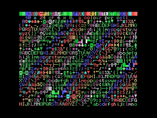
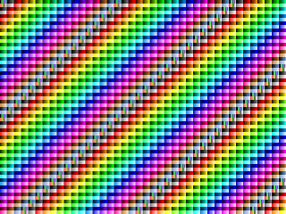
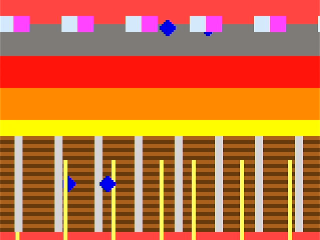

6502-PICOVDP
============



6502-PICOVDP is replacement firmware for the
[PICO9918 PRO](https://github.com/visrealm/pico9918) v2.0 video card. It turns
the card into a new video chip designed for the
[AC6502](https://github.com/acwright/6502-ACE), a family of 65C02 computers.

The PICO9918 PRO is built to stand in for a TMS9918A, the video chip of the
TI-99/4A, the MSX and the ColecoVision, and its stock firmware copies that chip
faithfully. 6502-PICOVDP keeps the TMS9918A's way of talking to the processor,
so software written for the TMS9918A's text mode still runs, and spends the rest
of the card's power on things the TMS9918A could never do: 256 colors on screen,
two scrolling layers, 64 sprites and 64 KB of video memory.

> 📖 **Guide:** [AC6502 Documentation](https://acwright.github.io/6502-DOCS/),
> the user's and programmer's guide for the whole family. Its chapters on
> [the screen](https://acwright.github.io/6502-DOCS/assembly/video) and
> [the graphics modes](https://acwright.github.io/6502-DOCS/assembly/graphics)
> teach this card from a program's side.

---

Contents
--------

- [What it does](#what-it-does)
- [Status](#status)
- [What you need](#what-you-need)
- [Installing it](#installing-it)
- [Programming it](#programming-it)
- [How it was built and tested](#how-it-was-built-and-tested)
- [Repository layout](#repository-layout)
- [Building from source](#building-from-source)
- [Credits](#credits)
- [License](#license)

---

What it does
------------

| | TMS9918A, and the stock PICO9918 | 6502-PICOVDP |
|---|---|---|
| Display modes | Text, Graphics I, Graphics II, Multicolor | Text, Compact, Graphics and Full, plus a legacy mode for Graphics I programs |
| Resolution | 256 × 192 | up to 320 × 240, shown at 640 × 480 VGA |
| Tile layers | 1 | 2, each scrolled on its own |
| Bits per tile pixel | 1 | 1, 2, 4 or 8, chosen per layer |
| Colors on screen | 15, plus transparent | 256, from 4096 |
| Palette | fixed | 256 entries, set by the program |
| Sprites | 32, 4 on a line, 1 color each | 64, up to 32 on a line, up to 255 colors each, flipped either way |
| Scrolling | none | hardware, per layer, a pixel at a time |
| Interrupts | vertical blank | vertical blank, a chosen scanline, sprite overflow, sprite collision |
| Video memory | 16 KB | 64 KB |
| Time between accesses | about 8 µs | none needed: a 2 MHz 6502 at full speed is fine |
| Ports | 2 | 4: two independent pairs, so an interrupt handler can use the card without disturbing the main program |
| Character set | loaded by the program | built in: the AC6502's 6 × 8 font is in video memory at reset |

The card answers in the AC6502's I/O slot 8, at `$9C00`–`$9C03`. A program
written for a TMS9918A uses `$9C00` and `$9C01` exactly as before; the second
pair, `$9C02` and `$9C03`, is a complete copy of the first.

These are pictures from the card's VGA output, captured while an ACE ran the
VDP Modes and VDP Layers sample cartridges: text mode with a color pair for
every character, Full mode's 320 × 240 at 8 bits a pixel, and two layers and
sprites scrolling over each other.

<p>



</p>

[SPEC.md](SPEC.md) is the complete description of the card: every register,
every mode, the timing, and the reasons behind each decision.

---

Status
------

**Version 1.0.0 is released and tested in a real machine.** The firmware image
is on the [v1.0.0 release page](https://github.com/acwright/6502-PICOVDP/releases/tag/v1.0.0).
It implements SPEC.md draft 0.5.

In an AC6502 ACE, at both 1 MHz and 2 MHz:

- BIOS 1.6, written for the TMS9918A, boots to BASIC with no change, and the
  AC6502 Documentation's first graphics sample, also written for the
  TMS9918A, draws what it drew there.
- BIOS 2.0, written for this card, finds it, boots, and scrolls the screen in
  hardware.
- The VDP Modes and VDP Layers cartridges match their reference pictures with
  no pixel of the card's output wrong.
- The ACE's 6502 made over 7 million of its fastest possible accesses to the
  card in a run, 2 µs apart at 2 MHz, and none was wrong.

On the test bench, an Arduino Nano driving the card's bus pins made
33.6 million reads and writes 2 µs apart, for an hour, under the heaviest
drawing load the card can be given, and none was wrong.

The full results, from the first timing test to the run in the ACE, are in
[docs/results/](docs/results/); [phase-14.md](docs/results/phase-14.md) is the
run in the ACE.

---

What you need
-------------

- **A PICO9918 PRO v2.0.** It uses an RP2354A (an RP2350 with 2 MB of flash
  built in). The earlier PICO9918 boards, v1.0 to v1.3, use an RP2040 and can't
  run this firmware: [SPEC.md §2](SPEC.md#2-target-hardware) explains why.
- **An AC6502 to put it in.** The [ACE](https://github.com/acwright/6502-ACE)
  uses it as its standard video card. A [COB](https://github.com/acwright/6502-COB)
  with a VGA Card, or a [VCS](https://github.com/acwright/6502-VCS) with an
  Output Board, can carry it too. Each machine's README says what its board
  needs.
- **A VGA monitor.** The firmware drives VGA at 640 × 480, through the PRO's
  VGA dongle.
- **[`picotool`](https://github.com/raspberrypi/picotool)** 2.x, to flash it.

The [6502-EMULATOR](https://github.com/acwright/6502-EMULATOR) runs the same
card in software, on the desktop and in the browser: choose 6502-PICOVDP under
Settings → VIDEO CARD. You can try programs there before you have the hardware.

---

Installing it
-------------

The [release notes](https://github.com/acwright/6502-PICOVDP/releases/tag/v1.0.0)
have the full steps and the image's checksum, and the ACE README's
[Video card](https://github.com/acwright/6502-ACE#video-card) section has the
same steps for an ACE. In short:

1. **Fit the `MDE1` pin.** Solder one 0.1″ header pin into the PRO's bare
   `MDE1` pad. Without it, the second port pair, `$9C02` and `$9C03`, can't be
   reached.
2. **Check the interrupt line.** The PRO drives its `/INT` pin both high and
   low, so it must reach the machine's shared `IRQB` line through a diode
   (a BAT85, cathode toward the card). Without the diode, the keyboard and
   serial input stop working. The machine's README says whether its board has
   the diode or needs one fitted.
3. **Back up the stock firmware**, if you may want it again: hold BOOT while
   connecting the PRO's USB-C, then run `picotool save -a stock.bin`.
4. **Flash the release:** hold BOOT while connecting USB-C, then run
   `picotool load -v -x -f picovdp-v1.0.0.uf2`. The release build has no USB
   connection of its own, so every later update needs the BOOT button again.
5. **Check it from BASIC.** On BIOS 2.x the boot screen's list of hardware
   ends in `VDP`, and `PRINT VSTAT(4);VSTAT(5);VSTAT(6)` prints `172 16 191`.

BIOS 1.x boots on the card unchanged, treating it as a TMS9918A. BIOS 2.x, from
[6502-BIOS](https://github.com/acwright/6502-BIOS), is written for this card:
it uses the built-in font and hardware scrolling, and its BASIC adds `SCREEN`,
`SPRITE`, `SCROLL`, `LAYER` and `PALETTE` for the new modes.

---

Programming it
--------------

- **[SPEC.md](SPEC.md)** is the reference: registers, modes, sprites, palette,
  interrupts, timing and how a program detects the card. It is also rendered as
  a printable datasheet, [docs/SPEC.html](docs/SPEC.html), saved as
  [docs/SPEC.pdf](docs/SPEC.pdf).
- **The [AC6502 Documentation](https://acwright.github.io/6502-DOCS/)** teaches
  the card step by step, starting from the text screen.
- **6502-EMULATOR's [docs/MIGRATING.md](https://github.com/acwright/6502-EMULATOR/blob/main/docs/MIGRATING.md)**
  covers moving a TMS9918A program to this card.
- **The emulator's [VDP Modes](https://github.com/acwright/6502-EMULATOR/tree/main/samples/vdp-modes)
  and [VDP Layers](https://github.com/acwright/6502-EMULATOR/tree/main/samples/vdp-layers)
  cartridges** are working assembly examples: one cycles through the four
  display modes, the other scrolls two layers past sprites.

---

How it was built and tested
---------------------------

The card's behavior was written down first, in SPEC.md, and implemented
twice: once in 6502-EMULATOR's `Video.ts`, in TypeScript, and once here, in C.
The emulator is the reference. Where the two disagree, one of them is wrong,
and the spec decides which.

The C is split in two. `core/` is portable C11 with no hardware in it: it is
the whole card, and it builds and runs on a desktop computer. `firmware/` runs
that core on the RP2354A's two processor cores, with the VGA output and the bus
on the chip's programmable I/O. Because the core runs on the desktop, it is
tested there against the emulator directly:

- The emulator's own unit tests run, unchanged, against the C core.
- A fuzzer sends millions of random operations to both and compares every read,
  every interrupt and every frame.
- Eighteen reference pictures (the goldens), captured from real programs
  running in the emulator (the BIOS, a game and the sample cartridges), are
  redrawn by the core from the same stream of port accesses, and every byte
  must match.

On the hardware, the same goldens are replayed on the card, first injected
over USB and then driven through its bus pins by an Arduino Nano, while a USB
capture card records the VGA output and scores it against the golden. The bench
is described in [docs/BENCH.md](docs/BENCH.md).

| Document | What it covers |
|---|---|
| [DESIGN.md](DESIGN.md) | How the firmware is built and checked: the rules the project follows, the architecture, the reference tests and the bench |
| [docs/BENCH.md](docs/BENCH.md) | The test bench: the Nano, the capture card and their wiring |
| [docs/TRACE.md](docs/TRACE.md) | The format of the recorded port accesses the goldens are replayed from |
| [docs/DEBUGLINK.md](docs/DEBUGLINK.md) | The debug build's USB link, and `vdpctl`, the tool that drives it |
| [docs/results/](docs/results/) | What each stage of the project measured and checked |

---

Repository layout
-----------------

| Path | Holds |
|---|---|
| `SPEC.md` | The specification. 6502-EMULATOR's `docs/VDP-SPEC.md` is a byte-identical copy, checked by `tools/check-spec.mjs` |
| `core/` | Portable C11: everything SPEC.md describes, with no hardware. `vdp.h` is the card; `vdp_debug.h` inspects it |
| `firmware/` | RP2350 only: `main.c`; `renderer.c`, the card on two cores; `vga/`, pico9918's VGA driver cut down to 640 × 480; `bus.pio` and `bus.c`, the four ports on the pins; `fault.c`, fault records, the watchdog and safe mode; and, in debug builds, `link.c`, `inject.c`, `scenes.c` and `profile.c` |
| `host/node/` | The core as a Node-API addon, with `Video.cjs` presenting it as the emulator's `Video` |
| `host/replay/` | `vdp-replay`: replays a trace into the core in pure C and checks each picture against its golden |
| `host/scene/` | `vdp-scene`: draws the firmware's worst-case test scenes on the desktop, the reference for the board's snapshots |
| `fonts/` | `cp437-6x8.bin`, the card's built-in font (SPEC §7), from 6502-BIOS v1.6. Checked by `tools/font.mjs` |
| `picovdp-default.*` | The default palette (SPEC §11) as GIMP and JASC palettes, and a reference image |
| `tests/unit/` | C unit tests, run by CTest |
| `tests/oracle/` | The emulator's goldens and traces, pinned. Written by `tools/sync-oracle.mjs` only |
| `tests/bench/` | Port conformance scripts for the Nano, played by `vdpctl conformance` |
| `tests/machine/` | The programs run on an ACE in the final test, as `.prg` files: the detection probe, the bus test, the sample cartridges from RAM and `graphics-1.asm`. Built by `make -C tests/machine`, run by `acectl` |
| `tools/` | Node ESM tools: `vdpctl`, `acectl`, `sync-oracle`, `replay`, `card`, `fuzz`, `font` and `check-spec` |
| `bench/nano/` | The Arduino Nano bus harness (PlatformIO) |
| `bench/hardware/` | The bench's schematic |
| `bench/cards/` | Test pictures this repository draws itself, for the capture card to score. Written by `tools/card.mjs` |
| `spike/` | The timing experiment from the start of the project, kept for reference |
| `external/pico-sdk` | pico-sdk 2.1.1, as a submodule |

---

Building from source
--------------------

Most people want the [release image](https://github.com/acwright/6502-PICOVDP/releases/tag/v1.0.0).
This section is for changing the firmware or running its tests.

### Requirements

On macOS: the Arm GNU Toolchain (`brew install --cask gcc-arm-embedded`),
CMake 3.25 or later, Ninja, `picotool` 2.x, Node 22 or later, and PlatformIO
for the Nano harness.

```sh
git clone https://github.com/acwright/6502-PICOVDP.git
cd 6502-PICOVDP
git submodule update --init
git -C external/pico-sdk submodule update --init lib/tinyusb
```

Only TinyUSB is needed from the SDK's own submodules. Don't initialize the rest,
and don't clone with `--recursive`.

### Host build and tests

```sh
cmake --workflow --preset host        # configure, build, ctest
cmake --workflow --preset host-asan   # the same under ASan and UBSan
```

The `host` preset also builds the Node-API addon,
`build/host/host/node/picovdp.node`, against the headers of the Node on `PATH`.
`host-asan` does not build it, because an instrumented addon cannot load into
Node.

### The reference from the emulator

The tools find `6502-EMULATOR` at `../../NodeJS/6502-EMULATOR`, or wherever
`PICOVDP_EMULATOR` points.

```sh
node tools/sync-oracle.mjs --check    # tests/oracle matches its manifest (CTest oracle_pinned)
node tools/sync-oracle.mjs            # re-sync; the emulator's HEAD must be on origin/main, clean
node tools/check-spec.mjs             # SPEC.md and the emulator's copy are identical (CTest spec_in_step)
```

A re-sync is a commit of its own (DESIGN.md ground rule 4).

### The font

```sh
node tools/font.mjs --check           # fonts/cp437-6x8.bin is font $00 (CTest font_pinned)
node tools/font.mjs show '$41-$5A'    # glyphs as 6 × 8 text
```

With a 6502-BIOS checkout at `../../Assembly/6502-BIOS` (or `PICOVDP_BIOS`), the
check also proves the file still derives from `v1.6:Chars.asm`.

### The core against the emulator

Build the `host` preset first. Then, in `6502-EMULATOR`:

```sh
PICOVDP_ADDON=/path/to/6502-PICOVDP/host/node/Video.cjs npm run test:picovdp
```

That runs the emulator's `Video.test.ts`, unchanged, against the core. In this
repository:

```sh
node tools/replay.mjs bios --classes               # a fixture's trace into the core, against tests/oracle (CTest replay_<fixture>)
node tools/replay.mjs --reference                  # every fixture into Video.ts instead: the harness's own check
node tools/fuzz.mjs --scope tiles --ops 10000000   # Video.ts against the core: reads, /INT, status and every frame
node tools/fuzz.mjs --scope frames --ops 8000000   # the same over random layer and sprite scenes, ~27,000 frames
node tools/fuzz.mjs --seed 1 --ops 100000          # the all scope: every read, /INT, and a frame every 5,000 operations
node tools/fuzz.mjs --self --scope tiles           # Video.ts against itself: the harness's own check
```

And with no Node at all, after building the `host` preset (CTest
`vdp_replay_<fixture>`, also under `host-asan`):

```sh
build/host/host/replay/vdp-replay --classes tests/oracle/*/*.vdpt.gz
```

With `PICOVDP_SPLIT_CHECK=1` set, the adapter builds every row a second time
with the division between the two cores at another column, and throws if the
row or the status differs. Any of the commands above can run that way.

The fuzzer and `replay.mjs --reference` load the emulator's compiled `Video`,
so run its `npm run build:cli` first. A divergence is minimized and written to
`build/fuzz/` as an operation list and, when the operations fit a trace, as a
trace.

### Firmware

| Preset | Board | Build |
|---|---|---|
| `pico2` | Raspberry Pi Pico 2 | debug: the debug link over USB, statistics, snapshots, injection |
| `pro-debug` | PICO9918 PRO v2.0 | debug |
| `pro-release` | PICO9918 PRO v2.0 | release: no USB, watchdog. This is the build that is published |

```sh
cmake --preset pico2 && cmake --build --preset pico2
node tools/vdpctl.mjs flash                       # picotool load -x -f, then INFO

cmake --preset pro-debug && cmake --build --preset pro-debug
PICOVDP_PRESET=pro-debug node tools/vdpctl.mjs flash
```

The first flash of a board needs it in BOOTSEL (hold BOOT while plugging in
USB). After that, a debug build is reflashed while it runs. `PICOVDP_PRESET`
says which build `flash` sends and which ELF a fault record is symbolized
against; it defaults to `pico2`. The Pico 2 drives VGA on GPIO 0–13 with
nothing attached; on the PRO the same pins reach the DAC.

Driving a debug build (all of [docs/DEBUGLINK.md](docs/DEBUGLINK.md) section 8):

```sh
node tools/vdpctl.mjs info                         # build, clock, reset reason, the last fault record
node tools/vdpctl.mjs stats                        # late rows, latency, stage maxima
node tools/vdpctl.mjs inject all                   # every golden checkpoint replayed on the board
node tools/vdpctl.mjs scenes --seconds 10 --stream # the worst-case scenes, snapshots checked
node tools/vdpctl.mjs late                         # a late line on purpose, checked against the host
node tools/vdpctl.mjs fault core1                  # a HardFault; the record, from safe mode
```

`scenes` and `late` need the `host` preset built, for `vdp-scene`.

With the capture card of [docs/BENCH.md](docs/BENCH.md) attached, the picture
is scored too:

```sh
node tools/vdpctl.mjs inject all --capture         # each checkpoint's picture, against its golden
node tools/vdpctl.mjs card dac                     # each channel's sixteen levels, measured
node tools/vdpctl.mjs card palette                 # SPEC §11's 256 entries, to look at
node tools/card.mjs all --png                      # redraw the bench cards from the reference
node tools/card.mjs --check                        # the cards still replay to their goldens (CTest cards_pinned)
```

### The Nano harness

```sh
cd bench/nano && pio run              # pio run -t upload to flash
```

With the Nano wired to the PRO ([docs/BENCH.md](docs/BENCH.md)), and the board
on `pro-debug`:

```sh
node tools/vdpctl.mjs bus                          # the wiring check
node tools/vdpctl.mjs conformance --timing all     # all four ports, against Video.ts
node tools/vdpctl.mjs replay all --timing all      # every golden checkpoint through the pins
```

### Testing in an ACE

With the release build on the PRO, the PRO in an ACE, the ACE's serial port
connected to the Mac and the capture card attached
([docs/results/phase-14.md](docs/results/phase-14.md)):

```sh
make -C tests/machine                              # the .prg files, into build/machine/
node tools/acectl.mjs info                         # STAT4-STAT6, through BASIC
node tools/acectl.mjs all --version '$10'          # on BIOS 2.0: probe, bus, bios, both cartridges
node tools/acectl.mjs all-1.6 --version '$10'      # on BIOS 1.6: bios, graphics-1, probe, bus
```

---

Credits
-------

The PICO9918 and PICO9918 PRO, and the pico9918 firmware they ship with, are
by Troy Schrapel ([visrealm/pico9918](https://github.com/visrealm/pico9918)).
6502-PICOVDP reuses pico9918's VGA driver and its bus PIO program, under its
MIT license; [THIRD_PARTY.md](THIRD_PARTY.md) lists every file taken and what
was changed.

---

License
-------

MIT — see [LICENSE](LICENSE). Third-party code is listed in
[THIRD_PARTY.md](THIRD_PARTY.md).
